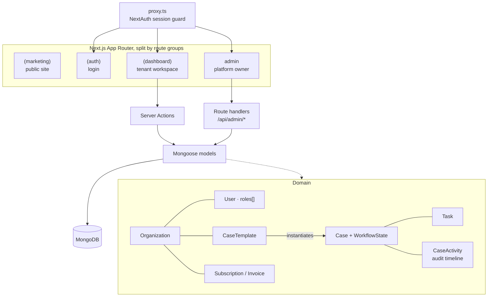
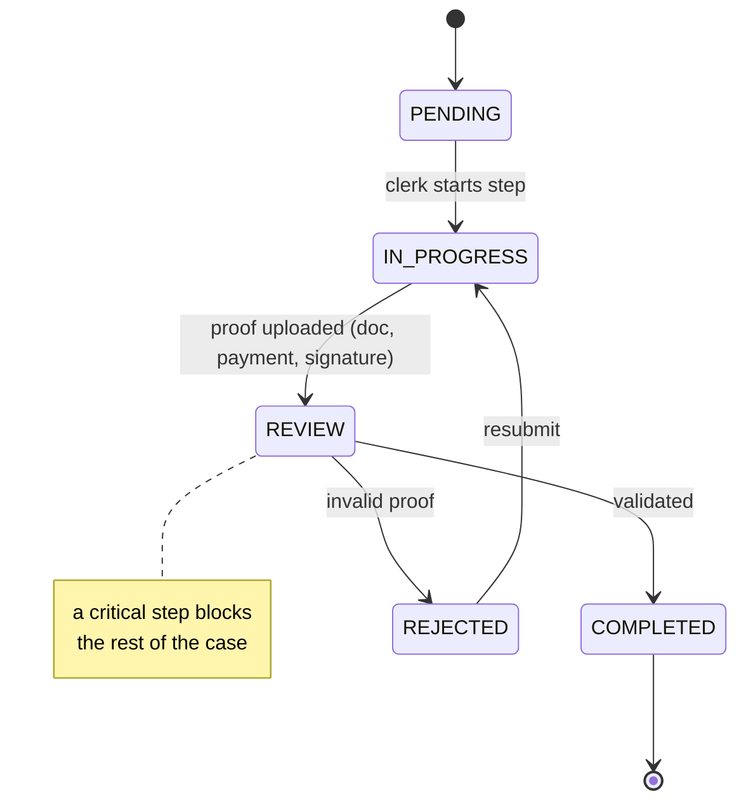
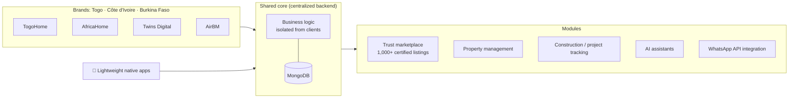
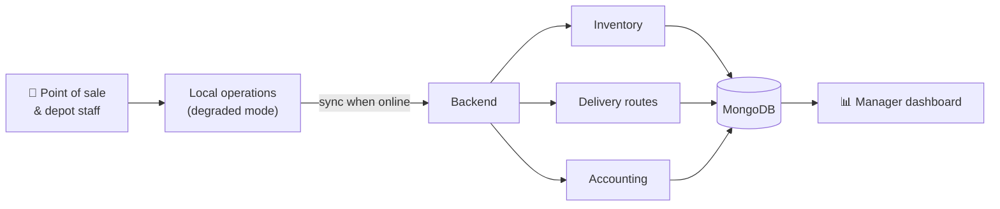
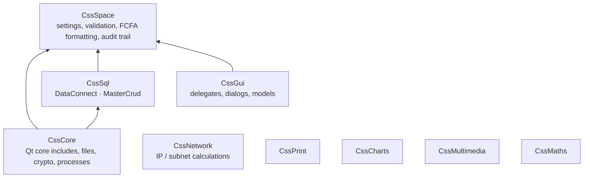
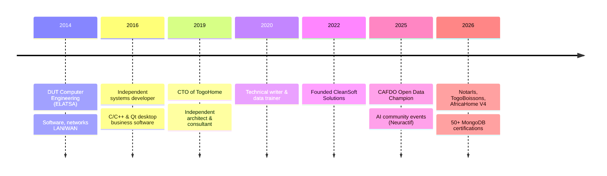

<h1 align="center">
  <samp>Martial A. C. AHADJI</samp>
</h1>

  <samp>Software Architect · Data Expert · DBA · Ops · Builder · Founder of CleanSoft Solutions</samp>

  <i>From C++ memory management to multi-tenant SaaS: I design whole systems, build them, run them, and lead the people who deliver them.</i>

  
  
  
  
  

---

## 🧭 Who I am, in one paragraph

I started in **C/C++ and Qt**, writing desktop software where every byte of memory mattered. Since then I've built and run production systems for distributors, notaries, real-estate platforms, schools and associations in Togo and the region. I've led a team of 21 and migrated a live platform from SQL to MongoDB without losing a single record. These days I hold **50+ MongoDB certifications**, build on **Next.js 16 / React 19 / TypeScript**, and write about **open data and African digital sovereignty**. Away from the keyboard, I also lead building construction projects, from structural design to site supervision.

This page shows what I've built and the range of roles I can fill, from code and databases to operations and construction sites.

---

## 🎯 What I can take on

| Role | What I bring |
|---|---|
| 🏛️ **Software Architect** | End-to-end system design: multi-tenant SaaS, ERPs, marketplaces, multi-country platforms. Took a production platform from V1 to V4. |
| 🗄️ **Database Administrator** | 50+ MongoDB certifications. Replication, sharding, indexing, performance tuning, backup & recovery, and live SQL → NoSQL migrations with zero data loss. |
| 📊 **Data Expert** | Data modeling, aggregation pipelines, analytics dashboards, data governance and open data. |
| 👨🏾‍💻 **Full-Stack Developer** | Next.js 16, React 19, TypeScript, Node.js on the web; C/C++ and Qt on the desktop. |
| ⚙️ **DevOps / Ops Manager** | Self-hosted VPS infrastructure (Coolify, Docker, Ubuntu), deployments, monitoring, high availability, and systems that keep running through power and network cuts. |
| 🧑🏾‍✈️ **Tech Lead / CTO** | Led a team of 21 (15 internal, 6 contractors), mentored junior developers, and aligned product with investors. |
| 🏗️ **Construction Project Lead** | Site supervision, coordination of tradespeople, quote consolidation, and structural design work such as concrete staircases and water-tower supports. |
| 🎓 **Trainer & Writer** | Data training programs, technical publications, and a practical guide to OHADA business law. |

---

## 🏗️ Systems I've designed

### 1. NotarIs: a multi-tenant workflow SaaS for notary offices
`Next.js 16` `React 19` `TypeScript` `MongoDB/Mongoose` `NextAuth v5` `Zod` `TanStack Table` `Recharts` `Tailwind 4`

Notary offices run long procedures such as property sales or company creation. Each one is a chain of documents, payments, signatures and forms. I modeled it as a **template-driven workflow engine**: an office defines a procedure once, and every new case is created from that template.

Each step has a **type** (`DOCUMENT · PAYMENT · SIGNATURE · FORM · INFO`), a config inherited from the template, its own runtime data, and a `isCritical` flag that blocks the next steps until it's done:

The platform also has session-based multi-tenancy, a super-admin who can **impersonate** a tenant (with a visible banner), team invitations by email, and a system log.

---

### 2. AfricaHome / TogoHome: a regional PropTech ecosystem (2019 → today)
`V1 → V4` `SQL → MongoDB migration` `3 countries` `4 brands` `21-person team`

I've been CTO since 2019. I took the platform from V1 to V4, moved it off a crashing legacy SQL database to MongoDB **with zero data loss**, and turned it into one shared core that serves several brands.

---

### 3. TogoBoissons: an ERP for a drinks distribution depot
`Offline-tolerant` `Inventory` `Delivery routes` `Real-time accounting` `1,500+ sales in one month`

This runs a real depot: stock, delivery rounds, cash and accounting. The constraint that shaped everything is that sales must continue during a power or network cut.

Also shipped: **FactuPro** (B2B invoicing, 300+ invoices a month in production), **NecroTogo** (B2C payments and donations with a vendor marketplace), **LYC Informatique V2** (e-commerce with WhatsApp checkout, OTP and B2B proformas), plus a school-management app and a writers' association platform.

---

### 4. From the metal up: my C++ / Qt toolkit
[`cpp-qt-css_library`](https://github.com/marsahadji/cpp-qt-css_library) · `C++` `Qt5` `qmake subdirs` `shared libraries (.dll / .a)`

Before the web, I built desktop business software in Qt. To avoid rewriting the same plumbing for every client, I split it into **separately compiled shared libraries** that every project linked against:

The toolkit also includes local phone-number validation, FCFA money formatting, and an audit trail that logs every user action to the database.

---

## 🗄️ Data is my home ground

- **MongoDB**: 50+ official certifications covering schema design, aggregation pipelines, indexing, replication, sharding, cluster performance, Vector Search & RAG
- **SQL**: PostgreSQL, MariaDB/MySQL, SQLite, SQL Server, Oracle (legacy). including a live SQL → MongoDB migration with zero data loss
- **Open data**: alumnus of the CAFDO Open Data Champions Network; certified training "Data and Innovation for Development" (2025)
- **Self-hosting**: my own VPS running **Coolify**, which hosts several production sites with external MongoDB and S3 storage

---

## 🛠️ Toolbox

**Today's stack**

  
  
  
  
  
  
  
  
  
  

**Systems & roots**

  
  
  
  
  
  
  
  

**Data & infrastructure**

  
  
  
  
  
  
  

---

## 🗺️ The road so far

---

## ✍️ Beyond code

- 📝 **Writing**: essays on open data, data governance and African digital sovereignty on [Substack](https://substack.com/@marsahadji). Author of *Au-delà du CFE*, a practical guide to OHADA business law (2026).
- 🎓 **Teaching**: I design data-analysis training programs and mentor junior developers and interns.
- 🎤 **Community**: organizer and panelist at AI events in Lomé.
- 🗣️ **Languages**: French & Ewe (native), English (C1/C2).

---

  
  

<samp>Most of my production work lives in private client repositories. Ask me for a walkthrough.</samp>

